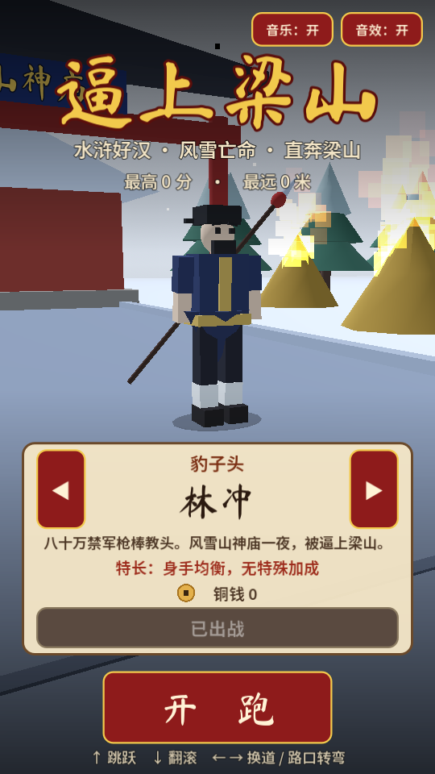
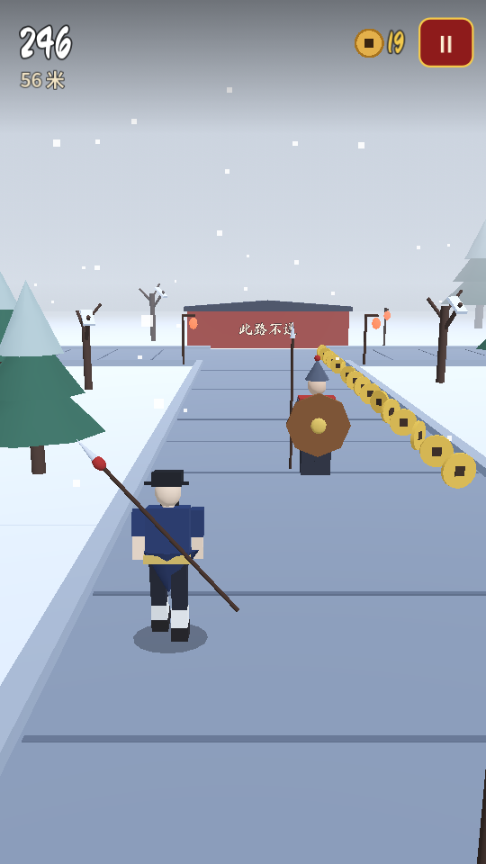
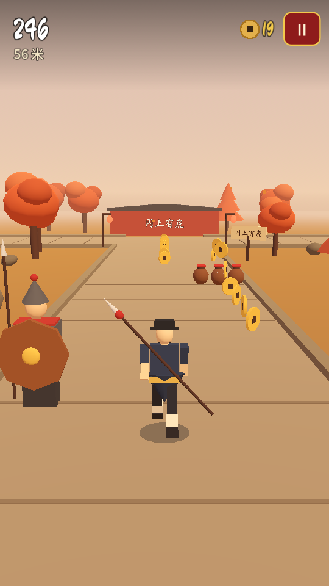
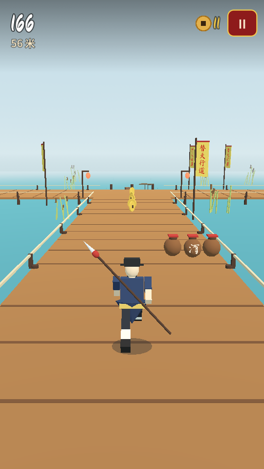

# 逼上梁山 · 水浒跑酷

一款类似《神庙逃亡》的安卓 3D 无尽跑酷游戏，题材取自《水浒传》：风雪夜林冲杀出山神庙，
身后是高俅派来的官兵，一路跑过野猪林、黄泥冈、景阳冈，直奔水泊梁山。

- 引擎：**Godot 4.7.2**（GDScript，Compatibility 渲染器，兼容 OpenGL ES 3 的老旧安卓机）
- 零外部美术 / 音频素材：场景、人物由基础几何体程序生成，音效和五声音阶配乐由合成器实时生成
- 完整设计文档见 [docs/GDD.md](docs/GDD.md)

| 主菜单 | 山神庙 | 景阳冈 | 水泊梁山 |
| --- | --- | --- | --- |
|  |  |  |  |

## 玩法

| 操作 | 触屏 | 键盘 |
| --- | --- | --- |
| 跳跃 | 上滑 | ↑ / W / 空格 |
| 翻滚（空中下滑可急降） | 下滑 | ↓ / S |
| 换道 | 左右滑 | ← → / A D |
| 路口转弯 | 路口前左右滑 | ← → / A D |
| 暂停 | 右上角按钮 / 返回键 | Esc / P |

- **障碍**：拒马 / 倒木（跳）、横幅（滚）、镖车 / 巨石 / 持盾官兵（换道）、断路断桥（跳）、酒坛（撞到会绊倒）。
- **路口**：T 字路口左右都能转，L 形弯只能转一边，错过就撞墙。
- **追兵**：绊倒一次官兵就追到身后，7 秒内再绊一次就被擒。
- **道具**：神行甲马（加速无敌）、护心镜（挡一次撞击）、聚宝盆（吸铜钱）、替天行道旗（得分翻倍）。
- **好汉**：林冲、武松、鲁智深、燕青、戴宗，用铜钱解锁，各有特长。
- **地域**：山神庙 → 野猪林 → 黄泥冈 → 景阳冈 → 水泊梁山，进入时显示对应的原著回目。

## 运行

1. 从 [godotengine.org](https://godotengine.org/download) 下载 Godot 4.7.2（标准版，非 .NET 版）。
2. 打开 Godot，导入本目录的 `project.godot`，按 F5 运行。桌面窗口用鼠标拖动即可模拟滑屏。

## 导出安卓 APK

**方式一：GitHub Actions（无需本地环境）**
每次推送都会运行 `.github/workflows/android.yml`：自检通过后导出调试版 APK，
在 Actions 页面对应运行的 Artifacts 里下载 `liangshan-debug-apk`。

**方式二：本地导出**
1. Godot 菜单「编辑器 → 管理导出模板」下载 4.7.2 模板。
2. 安装 Android SDK（含 platform-tools、build-tools）与 JDK 17，在「编辑器设置 → 导出 → Android」填好路径。
3. 「项目 → 导出」，选择已配置好的 Android 预设（arm64-v8a + armeabi-v7a，包名 `com.sungang.liangshanrun`），导出 APK。
   上架前请在预设中改用自己的正式签名（release keystore）。

## 自动化测试

```bash
# 约 10 秒跑完 450 秒模拟游戏时间：无操作会出局、结算、续命、3 个种子自动驾驶各跑 150 秒、存档与解锁
godot --headless --path . --fixed-fps 60 -- --selftest

# 截图（需要显示环境，Linux 服务器可用 xvfb-run）
xvfb-run godot --path . --fixed-fps 60 --rendering-driver opengl3 -- --selftest --shots=/tmp/shots
```

调试参数（写在 `--` 之后）：`--biome=liangshan` 从指定地域开跑，`--seed=42` 固定赛道，`--autopilot` 自动驾驶演示。

## 目录

```
scenes/main.tscn          主场景
scripts/main.gd           游戏流程、环境与天气
scripts/autoload/         GameState（存档、好汉、字体、输入）与 Sfx（程序化音频）
scripts/track/            赛道生成器、路段几何、障碍、拾取物
scripts/player/           玩家、人物模型与动画、追兵、自动驾驶
scripts/world/            道具工厂、地域配置、相机
scripts/ui/game_ui.gd     主菜单、HUD、暂停、结算
tests/self_test.gd        自动化自检
tools/make_font_subset.py 字体子集裁剪（新增汉字后运行）
docs/GDD.md               游戏设计文档
```

## 字体授权

`assets/fonts/` 中的字体为子集化后的 [马善政毛笔楷书](https://fonts.google.com/specimen/Ma+Shan+Zheng)
与 [思源黑体 Noto Sans SC](https://fonts.google.com/noto/specimen/Noto+Sans+SC)，均以 SIL Open Font License 1.1 授权，
许可证全文见同目录 `OFL-*.txt`。
